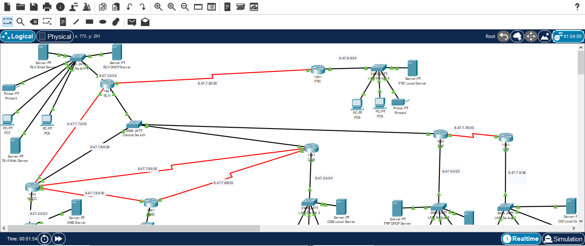

# CoastNet: Cyclone Early-Warning & Coastal Relief Network

A network simulation built in Cisco Packet Tracer for the CSE 421 course. It connects seven units of Bangladesh's cyclone early-warning and relief system (NDCC, BMD, CGB, RLH, FRC, TRP, COI) into one secure network.

## Topology

## What it does

- **VLSM subnetting:** one /16 base network divided across the seven unit networks and the point-to-point links
- **DHCP:** the NDCC router serves NDCC, BMD, and CGB, while RLH and TRP run their own DHCP servers. COI uses TRP's server, and FRC relays requests to RLH using an IP helper address
- **DNS and web:** a central DNS server in NDCC, with www.ndcc.relief.gov and www.rlh.relief.gov reachable from every unit
- **Email:** a local mail server for each unit (mail.ndcc.gov, mail.rlh.gov, etc.), with two-way email between ndcc.gov and rlh.gov
- **Routing:** RIPv2 between NDCC, BMD, and CGB with static route redistribution on NDCC, a default route on COI, static routes on RLH and TRP, and exit-interface static routes on FRC
- **Redundancy:** RLH reaches NDCC through TRP with a recursive static route if their direct link goes down, and TRP keeps a floating static backup route to NDCC via CGB

## Tech used

- Cisco Packet Tracer

## How to open

1. Download the `.pkt` file from this repo.
2. Open it with Cisco Packet Tracer.

## My contribution

I designed and configured the full network on my own, including:

- VLSM subnetting and the IP addressing plan
- Router configuration for all seven units
- DHCP, DNS, web, and email server setup
- RIPv2 with redistribution, static, default, recursive, and floating static routing
- Testing: ping between all devices, website and email access, and link failover

## Course

CSE 421,Brac University
